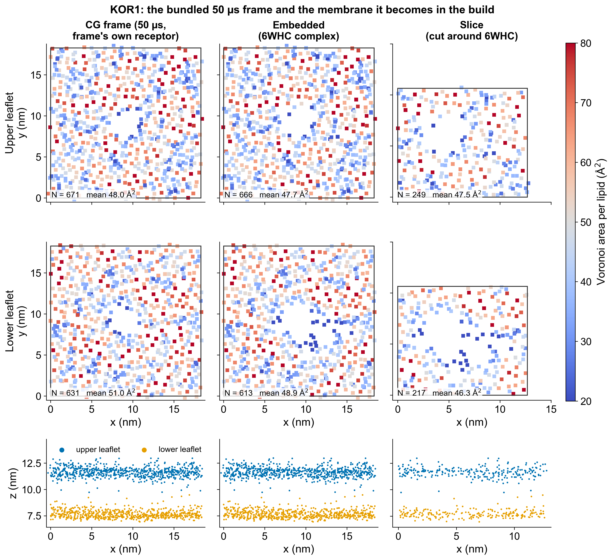
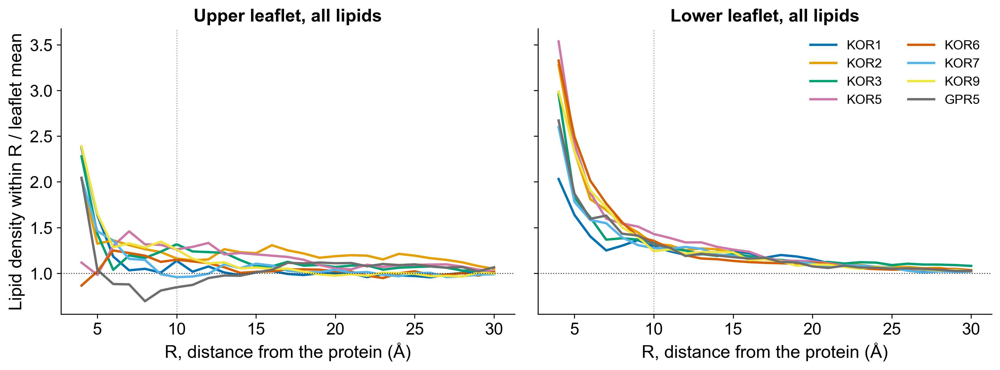

# MembraneForger tutorial: building and validating an all-atom membrane system

MembraneForger takes an all-atom protein (or protein-ligand) structure and a pre-equilibrated Martini 3 membrane
and returns a validated, energy-minimized CHARMM36/GROMACS system. This document explains what each stage does,
how the build is validated, and how to read the validation report (`membrane_validation.md`, `.json`, the figures)
that every build writes next to `em.gro`.

```
equilibrated Martini membrane (frame)
    -> orientation of the complex (OPM / PPM)                                          (orient)
    -> gate 0: the frame is graded on its own, absolute limits                         (validate_cg_frame)
    -> placement of the complex into the frame                                         (embed)
    -> embedded membrane: lipids pushed aside, only those it occupies removed, no pocket (the REFERENCE for slicing)
    -> PBC-aware, whole-lipid, anchor-based crop to the complex + buffer               (slice)
    -> gate 1: APL, composition, lateral RDF, thickness, protein orientation, integrity (slice_check)
    -> mstool backmapping around the rigid complex                                    (backmap, assemble)
    -> gate 2: the all-atom membrane (membrane.pdb), then the minimized system (em.gro)
    -> topology, box, water, ions, restrained + free minimization, audit               (publish em.gro)
    -> gate 3 and 4 on the equilibration / production trajectory                       (python -m membraneforger.equilibration)
```

Sections 1-4 are the build; section 5 is the validation, with 5.3 (slicing and global APL), 5.5 (species-specific
APL) and 5.12 (lateral RDF) the parts most readers come for; section 6 collects the thresholds; section 7 the
limitations; section 8 the settings.

## 1. Inputs

- `--aa complex.pdb`: the all-atom complex, the only source of protein and ligand chemistry.
- `--cg 1 | 2 | NAME | FILE`: a bundled GPR139 or kappa opioid receptor frame, random (`1`, `2`) or by name (`--list-membranes` lists them) (18.3 x 18.3 nm, about 1,300 lipids, ten
  species, 50 us of Martini 3), or your own Martini 3 frame.
- `--orient-chain R` names the chain that spans the membrane; `--nterm-side in|out` is needed by PPM when no OPM
  entry exists. The complete complex moves as one rigid body.

### 1.1 A frame must be periodic in its box

Everything after this point (slicing images, the seam, Voronoi cells, RDFs, equal-size windows) uses the periodic
cell on the frame's box line. A frame whose coordinates were rotated about z after the simulation (the usual cause is
a rotational fit, `gmx trjconv -fit rotxy+transxy` or similar, written without transforming the box) is no longer
periodic in that box: wrapping folds the corners of the rotated square onto its edges, beads of different molecules
land on top of each other there, the opposite corners stay empty, and the "diamond" one sees when rendering the file
is real data, not drift. The bundled 50 us frames are periodic in their boxes (`membraneforger/examples/align_frames.py`
finds no rotation in any of them); the same script rotates a user frame back in place (coordinates and velocities).

MembraneForger detects this when it reads a frame (`validation.align_frame_to_box`): it counts bead pairs of
different lipids closer than 0.30 nm after wrapping (an equilibrated Martini membrane has none; a rotated frame has
hundreds to thousands), scans the 90 degrees a square box allows for the rotation that removes them, refines it to
0.01 degree, and rotates the whole frame, water and ions included, back about the box centre. The angle and the
overlap counts before and after are logged (`WARN`) and recorded in `run_manifest.json` (`coarse_grain.frame_alignment`).
A frame that no rotation makes periodic (a non-square box, or coordinates that simply do not belong to the box line)
stops the build with a message saying so. The check stays on for every frame, so a user frame with the same
artefact is corrected the same way.

## 2. Placement and embedding

With a bundled membrane (or `--embed`) the oriented complex is placed where the frame's own receptor was (or, with
`--embed-site free`, on the unbroken bilayer away from it; see below), its
bilayer centre on the midplane found between the two PO4 planes (an oriented complex has it at z = 0; with
`--orientation none` it is `--bilayer-z`, else the midpoint of the CA z range of the segment `--orient-residues`
names, else the hydrophobic-belt search), and room is made for it (`embed_complex`). With
your own frame of the same complex the all-atom structure is fitted onto the frame's coarse-grained protein instead
and nothing is removed.

Room is made by moving lipids, not by deleting every lipid the complex touches. Every lipid with a bead within
0.40 nm of a heavy atom of the complex is pushed away at the coarse-grained level with the same restrained
steepest descent that relaxes the slice seam (`slicing.relax_seam`): a soft repulsion from the heavy atoms (range
0.45 nm), weak position restraints, restraints that keep each lipid's shape, and repulsion between lipid beads
that the push brings together (contact 0.30 nm), for 1200 steps. Only a lipid that still has a bead closer than
0.30 nm to a heavy atom afterwards is removed: the complex occupies its place. The log and `run_manifest.json`
(`embedding`) give how many lipids touched the complex, how many were removed (by species and leaflet), how far the
kept lipids moved and how much their shape changed, and the closest remaining bead.

Why: the earlier rule removed every lipid with any bead within 0.40 nm. A G protein's lipid anchors (the Ggamma
geranylgeranyl chain, the Galpha N-terminus) reach into the inner leaflet, and with the GCGR–Gs complex
that rule deleted every one of the 78-96 lipids touching the complex on the 8 bundled frames, many of them only for touching those
anchors. Each deleted lipid took its whole tail with it, leaving an empty column in the inner leaflet that solvation does not fill (water is
removed between the phosphate planes) and that the area-per-lipid gate cannot see (the Voronoi cells of the anchor
atoms absorb it). The current rule removes 20-31 lipids on the 8 bundled 50 us frames. Removing only lipids whose headgroup
anchor the complex occupies was also tried and rejected: next to a thin anchor it still deletes lipids whose volume
nothing replaces.

**Empty-pocket gate.** After embedding, the acyl region of each leaflet (0.3 nm off the midplane to 0.3 nm inside
its PO4 plane) is sampled on a 0.1 nm grid; a point farther than 0.60 nm from every lipid bead and every heavy atom
of the complex is empty, and touching empty points form a pocket (`membrane_voids`, periodic in x and y). A pocket
larger than 1.0 nm^3, less than the volume of one phospholipid, stops the build before slicing, naming the leaflet and
the position. On the 8 bundled 50 us frames with the GCGR complex: uncut frames 0.007-0.066 nm^3, this embedding
0.019-0.272 nm^3. If the gate stops a build, the frame's cavity cannot be adapted to the
complex by moving lipids; use a coarse-grained frame of the complex itself (`--cg FILE`) or another frame.

**Embedding site (`--embed-site`).** A bundled frame was equilibrated around a receptor, and where the receptor was
it has a hole of the receptor's shape (empty acyl volume once the receptor is taken out). The default site, `hole`, puts the complex there, which suits another receptor of similar size. A much smaller
complex cannot fill it: a single-pass protein (one transmembrane helix) left a pocket of 1.7-2.9 nm^3 in the receptor's hole of every bundled 50 us frame (2.87 nm^3 in GPR139, 2.53 nm^3 in KOR,
1.68 nm^3 in KOR_Membrane5) even after the push, and the empty-pocket gate stops the build with a message naming the other site.
With `--embed-site free` the complex goes on unbroken membrane instead, and the push makes room for it. The site is
chosen for the membrane that will be cut around the complex, not for its helix alone: the slice window (the
complex's x/y extent plus `--xy-buffer`, or `--box`, plus the 0.5 nm crop offset the slicer may take;
`embedding.slice_window`) is tried at every point of the cell, and the point where it stays farthest from the
frame's receptor is used (`embedding.free_site`, periodic in x and y). The window must keep 1.0 nm from every
receptor bead (`FRAME_PROTEIN_CLEARANCE_NM`: in the bundled frames no lipid bead comes closer than 0.32-0.37 nm to
a receptor bead, so the hole reaches that far past the bead centres); if no point does, the build stops before the
push. The receptor's beads count as solid in the pocket search, and after slicing the build checks the actual window
again (`frame_protein_in_slice`). A single helix with the default 1 nm buffer gives a cell of
about 4 nm, where the cut edges alone can move the APL past the slice gate; give it a larger buffer (`--xy-buffer 3`;
with it all 8 bundled frames pass the slice gate with the centred window; the +5.4 % KOR_Membrane7 deviation reported for the offset-search build is not reproduced).

The membrane that exists after this step is the **embedded membrane**. It is the reference every later stage is
compared with: it is the membrane the slice is actually cut from. The uncut frame is also measured ("CG frame"
row) so that the effect of embedding itself is visible; this comparison is reported and not graded. It is not a
measure of packing: the frame's footprint is tessellated with the coarse-grained protein beads and the embedded
membrane's with the complex's heavy atoms, which are far denser generators. On the matched GCGR frame the same lipids
give a lower-leaflet APL of 57.3 A^2 with the CG protein and 48.3 A^2 with the fitted all-atom complex.



*Figure 1. The coarse-grained membrane of the KOR build at its three coarse-grained stages: the bundled 50 us frame
with its own receptor, the membrane after embedding the GCGR complex, and the slice cut around it (1302, 1279 and 466
lipids). Top-down view of each leaflet and side view (x-z), coloured by the Voronoi area per lipid. "After" means after
embedding and slicing: the build does not equilibrate the coarse-grained membrane, and the figure is drawn by
`membraneforger/examples/make_tutorial_figures.py`.*

## 3. Slicing (BOX = auto)

The window is the complex's x, y extent plus `--xy-buffer` (1.0 nm) on each side; an axis whose window would reach
the cell is not cut. The cut is made lipid by lipid:

1. every lipid is made whole under the periodic boundaries of the source cell;
2. one **anchor** represents the lipid in the plane (`membraneforger/lipids.py`, `LIPID_SLICE_ANCHORS`):

   | Lipid | Martini 3 anchor | atomistic anchor (CHARMM36) |
   |---|---|---|
   | POPC, DOPC, POPE, DOPE, POPS, DOPS, PSM | `PO4` | `P` |
   | PIP2 (`SAP6` / `SAPI25`) | `PO4` (the diester phosphate, not P4/P5) | `P` |
   | cholesterol (`CHOL` / `CHL1`) | `ROH` | `O3` |
   | GM3 (`DPG3` / `GLPA`) | centroid of the three sugar residues' beads (GLC, GAL, NMC) | `NF` (ceramide amide N) |
   | anything else | centre of geometry of the whole residue | centre of geometry of the heavy atoms |

3. the periodic image of the anchor that falls into the **half-open** window `lower <= a < lower + width` is found.
   The window is never wider than the cell, so exactly one image qualifies: no lipid is counted twice and a lipid on
   a boundary is counted on one side only. This is the decision one gets from tiling the membrane 3 x 3 and cutting
   the window out of the tiling, without building the tiling;
4. if the anchor is in the window the **complete residue** is kept and moved rigidly by the same shift; a tail bead
   that crosses the new cell edge stays where it is (mstool runs with `pbc=True`, GROMACS wraps);
5. the window is centred on the complex. Opt in to `--slice-offset-search` and it may be shifted on a cropped axis by
   up to 0.5 nm (never past the 0.5 nm minimum margin) in steps of 0.1 nm, to the offset whose lipid counts best match the
   reference leaflet density and composition. Centred is the default because on the 8 bundled 50 us frames (GCGR complex)
   the construction deviation of section 4 is smaller with the centred window (median 0.71 %, 95th percentile 1.88 %,
   largest 2.19 %) than with the search (1.55, 3.39, 4.87 %), and the search gains nothing in the spread of the
   whole-cell deviation. The trade-off is in the report: the centred slices of KOR_Membrane5, KOR_Membrane6 and KOR_Membrane9 sit 11-12 % below the
   whole embedded cell in the lower leaflet (percentile 0.99-1.0 of the equal-size windows, PASS WITH WARNINGS), where
   the search gave one construction warning (KOR_Membrane5 lower, +4.87 %);
6. the new periodic seam is relaxed in place at the coarse-grained level: a short steepest descent pushes apart
   beads of different lipids that only the cut brought within 0.30 nm of each other, with the complex as a fixed
   repulsive wall, every bead held near its position and every lipid held in shape by intramolecular distance
   restraints. Pairs that were already that close in the source frame are data and are left alone. Only a lipid
   still in a hard-core overlap (< 0.15 nm) afterwards is removed; on the 8 bundled 50 us frames none was (the seam removed 0 lipids on all of them). The
   relaxation moves 42-56 % of the lipids by 0.016-0.030 nm on average and 0.39 nm at most; KOR_Membrane1, KOR_Membrane7 and KOR_Membrane9 reach the 400-step cap, the converged frames take 154-260 steps.

### Why whole-lipid anchoring

Keeping a lipid only when every bead lies inside the window deletes a band of lipids along every cut edge, because tails
reach a nanometre sideways, while the new cell keeps the full window area: the lipid number falls by 15-30 % per unit area
and the two leaflets lose different amounts. Neither minimization nor NPT can repair this, since both leaflets share one
x, y cell.

## 4. Backmapping and the rest of the build

mstool backmaps the sliced membrane around the complex held as a rigid obstacle, the structure is checked for ring
threading and stereochemistry (another seed is tried when needed; contact findings between the membrane and the complex are logged as a warning and left to the minimization), the topology is built, the box is set in
z, water and 0.15 M NaCl (in the water, see below) are added, the system is minimized with and then without the lipid dihedral restraints, and
an independent audit must pass before `em.gro` appears. Every intermediate is kept: at the end of each build, passed
or failed, the steps on the way to `em.gro` (`config.INTERMEDIATES`) are moved into `<out>/int/`, beside the working
files (`int/work`) and the audit's scratch runs (`int/audit`); the top level holds the final outputs and the reports.
A retried backmapping seed keeps the earlier attempt (`int/work/mstool_before_seed<N>`,
`int/work/membrane_seed<N>.pdb`).

### 4.1 Disulfides

Disulfides are read from the all-atom input's geometry at the topology stage, which is the first stage with
anything to bond (orientation, placement, slicing and backmapping move the complex as one rigid body, so detecting
them earlier would give the same answer): two cysteine SG atoms closer than 3.0 A are bonded, a pair whose SG-SG
distance lies outside 1.8-2.2 A is rebuilt at 2.03 A before pdb2gmx, the topology is read back and must contain
exactly the detected pairs, and the pairs are listed in the log and in `run_manifest.json` (`disulfides`). The
audit measures every SG-SG bond of the topology on the minimized structure and fails the build if one is outside
1.8-2.2 A. Limitations: SSBOND records are not read and detection is by distance alone, so a reduced pair modelled
within 3.0 A becomes a bond and a pair stretched beyond 3.0 A in a model is missed (check the `disulfides` list in
the manifest against what you expect); a disulfide between two chains is refused, because each chain gets its own
topology; a cysteine within 3.0 A of two others is refused as ambiguous.

`--exclude-disulfide CHAIN:RESID-CHAIN:RESID` answers the first of those limitations: the named pair is left
reduced although its SG atoms are within 3.0 A, so a close contact a predicted model produces where the chemistry
does not support a bond does not become one. pdb2gmx is run with `-ss` for that chain and told not to link it, and
both cysteines are built as reduced CYS with their HG1 hydrogen; coordinates are untouched. See
[advanced options](advanced.md#disulfides).

## 5. Validation

### 5.1 What is measured, and where

Every stage is reduced to one record per lipid (anchor position, leaflet, species) and the heavy atoms of the
complex, so the same code measures the coarse-grained and the atomistic stages. The report's stage matrix:

| Validation | CG frame | Embed | Slice | Backmap | Minimized | Equilibrated | Final |
|---|---|---|---|---|---|---|---|
| CG frame quality (absolute, before embedding) | ✓ | | | | | | |
| Ring penetration / clashes (build) | | | ✓ | ✓ | ✓ | | |
| Voronoi APL (global and per species) | ✓ | ✓ | ✓ | ✓ | ✓ | ✓ | ✓ |
| Lateral headgroup RDF | ✓ | ✓ | ✓ | | | | |
| Lipids around the protein (per species, per leaflet) | | ✓ | ✓ | ✓ | ✓ | ✓ | ✓ |
| Bilayer thickness (global, local map) | ✓ | ✓ | ✓ | ✓ | ✓ | ✓ | ✓ |
| Composition / leaflet asymmetry | ✓ | ✓ | ✓ | ✓ | ✓ | ✓ | ✓ |
| Z-density / core hydration | | | | | ✓ | ✓ | ✓ |
| Tail interdigitation | | | | ✓ | ✓ | ✓ | ✓ |
| Protein tilt / insertion depth | ✓ | ✓ | ✓ (diagnostic) | ✓ | ✓ | ✓ | ✓ |
| Tail order S_CD | | | | | | ✓ | ✓ |
| Area / volume convergence | | | | | | ✓ | ✓ |
| Lateral diffusion, K_A, leaflet tension | | | | | | | ✓ |

The build runs the first five columns. The last two need a trajectory and are run afterwards with
`python -m membraneforger.equilibration` (section 5.9). The lateral RDF is confined to the coarse-grained stages
because the all-atom anchors (P, O3, NF) are not the Martini beads: a cross-resolution curve is reported in the
JSON but not graded. Everything ends in one record format (`membraneforger/qc.py`): metric, stage, leaflet, value,
units, reference, uncertainty, N, deviation, status (PASS / WARNING / FAIL / INSUFFICIENT SAMPLING / REFERENCE
NEEDED / NOT RUN) and the reason. Poor sampling is never turned into a PASS or a FAIL.

### 5.2 Two different areas per lipid

Keep these apart; the report does.

- **Global leaflet APL**: `APL_global = (A_xy - A_protein) / N_lipids`. It tests overall packing.
- **Local, per-lipid area**: the cell of each lipid in a 2D periodic Voronoi tessellation of its leaflet, generated
  from the headgroup anchors with the heavy atoms of the complex that lie between the midplane and the headgroup
  plane as additional generators whose cells are discarded. The protein footprint is therefore never assigned to a
  lipid, `sum(A_i) = A_xy - A_protein` exactly (A_protein is the summed area of the protein generators' cells), and the
  global APL is the mean of the per-lipid areas. This is an anchor-based area, one generator per lipid; it is not the
  all-atom APL@Voro sum of atom cells, so the two are not interchangeable.
- **Species APL**: the mean (and median, SD, IQR) of the per-lipid areas of that species, per leaflet.
  "Available area divided by the number of POPC" is not the APL of POPC in a mixed bilayer and is not computed.
- **Head-plane area**: a second tessellation of the phosphate/amide anchors alone, sterols left out because their
  ROH sits about 0.5 nm below the phosphate plane. This is the area per lipid head in the headgroup plane
  (59-66 A^2 in the KOR build against 46-51 A^2 for the all-lipid value, the difference being the cholesterol).

### 5.3 Slicing and the global APL

The slice is compared with the embedded membrane in two ways, and only the first is a pass/fail criterion:

- **Construction check**: the leaflet APL of the slice against the Voronoi areas of the **same lipids in the
  uncut embedded membrane**. The cut keeps those lipids with their neighbours; only the new seam can change their
  areas, so this isolates what slicing did. PASS within 3 %, WARNING to 5 %, FAIL beyond (and the build stops
  before backmapping unless `--apl-validate no`; `--apl-tolerance` moves the FAIL ceiling).
- **Representativeness**: the slice against the whole embedded cell, and the lipid count against the count the
  reference APL predicts for the accessible area of the new cell. A finite crop around a protein samples the
  membrane next to that protein, not the cell average, so this is graded against the empirical distribution of
  equal-size windows cut everywhere in the embedded membrane (central 95 % PASS, 95-99 % WARNING) and never stops
  the build.

Measured on the bundled kappa opioid receptor frame KOR with the oriented glucagon receptor complex (GCGR)
embedded, sliced with the default settings (centred window; the values come from `membrane_validation.md`; the old-rule row is the lipid
count the all-beads-inside rule keeps in the same window, with the APL that count implies):

| Stage / algorithm | Upper lipids | Lower lipids | Upper APL (A^2) | Lower APL (A^2) | dAPL upper vs embed | dAPL lower vs embed | Verdict |
|---|---:|---:|---:|---:|---:|---:|---|
| CG frame (frame's own receptor) | 671 | 631 | 48.0 | 51.0 | | | |
| Embedded CG membrane (reference) | 666 | 613 | 47.7 | 48.9 | reference | reference | |
| Old all-beads-inside slice | 214 | 186 | 55.3 | 54.0 | +15.9 % | +10.4 % | FAIL |
| New anchor slice, centred + relaxed seam | 249 | 220 | 47.5 | 45.6 | -0.4 % | -6.6 % | PASS |
| same lipids in the uncut membrane | 249 | 220 | 47.6 | 45.5 | construction: -0.15 % | +0.16 % | PASS |

The old rule deleted 69 lipids whose anchor was inside the window because one tail bead
crossed the edge. The new slice keeps them; the seam relaxation moved 217 lipids by 0.021 nm on average (0.39 nm at
most) and removed none. The lower leaflet is 6.6 % denser than the whole embedded cell (percentile 0.75 of 144
equal-size windows): the construction check passes, the difference is where the window sits. With the offset search
(`--slice-offset-search`) the same frame gives 249 / 217 lipids, -0.4 % / -5.3 % against the whole cell and
+1.2 % / +1.7 % construction deviation.

Over all 8 bundled 50 us frames (16 leaflets, GCGR complex, centred window) the construction deviation of the
new slice has a median of 0.71 %, a 95th percentile of 1.88 % and a largest value of 2.19 % (1.55, 3.39 and 4.87 % with
`--slice-offset-search`), so the 3 % warning level is not crossed on any frame; the old all-beads-inside rule would have failed on every frame
(+14.0 to +19.2 % upper, +6.5 to +12.2 % lower, 68-91 fewer lipids). The whole-cell
deviation of a correct crop scatters more (standard deviation 1.5 % upper and 2.4 % lower leaflet, worst case 14.3 %, lower leaflet of KOR_Membrane7), which is why it is reported as representativeness
and not used to stop the build; three frames (KOR_Membrane5, KOR_Membrane6, KOR_Membrane9) end PASS WITH WARNINGS on it.

The repaired slice therefore preserves the embedded membrane's packing to within 2-3 % per leaflet on the
representative cases and within 5 % on every bundled frame tested; it does not preserve it "perfectly", and the
report says by how much.

Area per lipid (A^2, Voronoi, protein footprint excluded) at each stage for the 8 bundled frames with the GCGR complex
(centred window; the last column is the construction deviation with `--slice-offset-search`). "Uncut" is the same lipids as the slice, in the embedded membrane; the construction
deviation is the slice against them. Head-plane is the area per phosphate/amide anchor (section 5.2).

| Frame | Leaflet | CG frame | Embedded | Slice | Uncut | Construction | Head-plane embedded | Head-plane slice | Construction, offset search |
|---|---|---:|---:|---:|---:|---:|---:|---:|---:|
| KOR_Membrane1 | upper | 47.99 | 47.72 | 47.54 | 47.61 | -0.15 % | 65.72 | 63.80 | +1.17 % |
| KOR_Membrane1 | lower | 51.04 | 48.87 | 45.62 | 45.55 | +0.16 % | 63.47 | 59.00 | +1.73 % |
| KOR_Membrane2 | upper | 47.87 | 47.64 | 45.95 | 45.64 | +0.69 % | 65.84 | 62.48 | +2.90 % |
| KOR_Membrane2 | lower | 51.66 | 49.29 | 44.14 | 43.82 | +0.73 % | 63.47 | 55.90 | -0.58 % |
| KOR_Membrane3 | upper | 47.36 | 47.24 | 45.82 | 45.65 | +0.38 % | 66.06 | 63.00 | +1.65 % |
| KOR_Membrane3 | lower | 52.11 | 50.06 | 45.90 | 45.67 | +0.50 % | 63.71 | 58.39 | +1.46 % |
| KOR_Membrane5 | upper | 46.76 | 46.79 | 45.38 | 45.05 | +0.73 % | 65.37 | 63.28 | -0.39 % |
| KOR_Membrane5 | lower | 51.63 | 49.19 | 43.11 | 43.21 | -0.23 % | 62.38 | 55.82 | +4.87 % |
| KOR_Membrane6 | upper | 47.12 | 46.90 | 47.19 | 46.37 | +1.77 % | 65.51 | 66.66 | +0.12 % |
| KOR_Membrane6 | lower | 51.92 | 49.76 | 44.03 | 45.02 | -2.19 % | 63.29 | 56.55 | +1.95 % |
| KOR_Membrane7 | upper | 46.90 | 46.68 | 45.29 | 45.81 | -1.14 % | 66.05 | 63.73 | +0.37 % |
| KOR_Membrane7 | lower | 52.72 | 50.38 | 43.26 | 42.71 | +1.30 % | 63.24 | 55.72 | +2.26 % |
| KOR_Membrane9 | upper | 47.75 | 47.64 | 46.52 | 46.63 | -0.25 % | 66.35 | 63.94 | +1.70 % |
| KOR_Membrane9 | lower | 51.89 | 50.33 | 44.89 | 45.07 | -0.41 % | 64.16 | 57.91 | -0.65 % |
| GPR139_Membrane5 | upper | 46.86 | 46.95 | 47.03 | 46.25 | +1.69 % | 65.80 | 65.07 | +2.09 % |
| GPR139_Membrane5 | lower | 51.39 | 49.70 | 46.02 | 46.52 | -1.08 % | 63.66 | 59.51 | +0.52 % |

The KOR rows are the stage table above. With the centred window no leaflet crosses the 3 % construction warning level; with
the search `KOR_Membrane5` lower (+4.87 %) is the one that does (PASS WITH WARNINGS).

### 5.4 Composition and leaflet asymmetry

For each leaflet and species the report gives N and the mole fraction in the reference and in the slice, the
difference in mole percent, the sampling standard deviation a random crop of that many lipids would have, and the
composition distance `D_comp = 0.5 * sum |x_slice - x_reference|` (the total variation distance). D_comp is graded against the equal-size-window distribution
(and against three times the multinomial expectation when fewer than 20 windows exist). Rare species (PIP2, GM3,
10-20 molecules in a cut) are shown with their N and flagged "(few)" below 10; their mole fractions move by one or
two points between reference and slice and their species APL has a standard deviation of 20-25 A^2 across molecules,
so a difference of a few percent in their mean carries no weight.

### 5.5 Species-specific APL

The species table (and `membrane_validation_species.png`) lists, per stage, leaflet and species: N, mean, median,
SD and head-plane area of the per-lipid Voronoi cells, the mole fraction, and the change against the reference.
In the KOR build the well-sampled species (N >= 30) change by -9.9 to +8.4 % between the embedded membrane and
the slice (largest: lower CHOL -9.9 %, upper PSM +8.4 %), a wider spread than the global check; upper DOPE, with 9
molecules, moves by +6.9 % and is marked. Cholesterol's cell (38 A^2 in the upper leaflet, 35 in the lower) is smaller
than a phospholipid's (46-55 A^2 for N >= 10) because its anchor shares the plane with the phosphates it sits between;
the head-plane column, which excludes it, is the area a phospholipid head occupies among heads (55-69 A^2 for N >= 10).
Per-lipid areas are written to `membrane_validation_lipids.tsv`.

### 5.6 Bilayer thickness and protein orientation

Thickness is the distance between the median anchor z of the two leaflets (non-sterol lipids), plus a 1 nm local
map whose spread is reported. Protein orientation is the tilt of the principal axis of the complex's heavy atoms
within 1.5 nm of the midplane, its insertion depth (mean z of those atoms relative to the midplane) and an inversion
flag. Across slicing (gate 1) thickness is graded: it may change by 3 / 5 % (PASS / WARNING) against the embedded membrane.
Slicing only removes and shifts lipids and never moves the complex, so its tilt, insertion depth and side of the membrane are the embedded values to
rounding; they are reported at the slice stage as diagnostics (NOT RUN, deviation 0.0) and graded where they can change,
across backmapping and minimization (tilt 2 / 5 degrees, depth 1 / 2.5 A). In the 50 us KOR example embedding changes thickness by 0.1 %
(42.58 to 42.61 A) and slicing by -2.0 % (41.74 A, PASS; -1.7 % with the offset search). An earlier version of the report dropped this
slice-stage thickness record: its merge with the gate's own records compared metric names across all stages, so the
`bilayer thickness` of the CG frame and of the embedded membrane hid the slice's. It is now compared with the gate's records only.

### 5.6a Lipids around the protein

The lateral RDF above is lipid to lipid; how each species is distributed around the protein is a separate profile
(`rdf.protein_density_profiles`, section "Lipids around the protein" of `membrane_validation.md`, figure
`membrane_validation_protein_density.png`). For every lipid of a leaflet it takes the in-plane distance from the
headgroup anchor to the nearest protein heavy atom of the protein's cross-section at headgroup depth (within 0.6 nm
of the leaflet's median anchor z). Each distance shell's membrane area is measured on a 0.05 nm grid (the protein is
not a cylinder), and the species' density is divided by its mean density over the leaflet's lipid-accessible area:
1 = as common as anywhere, > 1 enriched next to the protein, < 1 depleted. One frame puts zero or one molecule of a
species in each shell, so the figure shows the cumulative ratio, the density within R over the leaflet mean (a
depletion-enrichment index), which tends to 1 far from the protein; the table gives its value at 10 A, the first
shell, with the counting uncertainty (ratio / sqrt(n)). The cross-section is taken at headgroup depth because a
tilted helix shifts laterally by up to 2 nm across a leaflet: against all protein atoms of the leaflet, even the
total lipid density read 1.3-1.4 at the protein for a single-pass protein tilted 53 degrees (0.9-1.1 at headgroup
depth). The CG frame stage is left out: its protein is the frame's own receptor, not the complex.



*Figure 2. Cumulative density of all lipids within R of the protein over the leaflet mean, slice stage, GCGR complex,
for each bundled frame and leaflet; 1 = as common as anywhere. The first shell (R = 10 A) is marked.*

Ratio at 10 A, with the lipids in the shell and in the leaflet in brackets:

| Frame | Upper, embedded | Upper, slice | Lower, embedded | Lower, slice |
|---|---|---|---|---|
| KOR_Membrane1 | 1.12 (28/666) | 1.14 (28/249) | 1.37 (70/613) | 1.28 (70/220) |
| KOR_Membrane2 | 1.15 (29/671) | 1.14 (29/258) | 1.44 (73/611) | 1.34 (73/225) |
| KOR_Membrane3 | 1.35 (34/677) | 1.32 (34/260) | 1.33 (67/600) | 1.29 (68/217) |
| KOR_Membrane5 | 1.30 (33/676) | 1.27 (33/262) | 1.55 (79/606) | 1.36 (79/236) |
| KOR_Membrane6 | 1.14 (29/676) | 1.16 (29/252) | 1.46 (74/603) | 1.32 (74/228) |
| KOR_Membrane7 | 0.98 (25/684) | 0.97 (25/261) | 1.51 (75/597) | 1.24 (74/234) |
| KOR_Membrane9 | 1.24 (31/672) | 1.22 (31/255) | 1.35 (67/599) | 1.24 (67/224) |
| GPR139_Membrane5 | 0.83 (21/672) | 0.85 (21/251) | 1.31 (66/597) | 1.30 (66/215) |

The lower leaflet is enriched next to the protein in every frame (1.24-1.55) and the upper leaflet ranges from depleted
(GPR139, 0.83) to enriched (KOR_Membrane3, 1.35). Figure 2 was drawn from slices made with the offset search; the slice values in this table, from the default
centred window, differ from it by at most 0.1.

**Reading the minimized and trajectory .gro files.** The .gro format keeps 5 characters of a residue name (SAPI25 is
written SAPI2) and the GM3 topology splits each molecule into four residues (CER160 BGLC BGAL ANE5AC, written CER16
BGLC BGAL ANE5A). The minimized stage and the equilibration frames therefore take their molecules from the build's
topology (`topol.top` and its .itp files), which is exact; without a topology that matches the file, the residue
names are mapped back with those two rules. A molecule that is neither lipid, protein nor solvent is reported
(`WARNING`, "molecules identified") and left out of every measurement.

### 5.7 Integrity

Every kept lipid is complete, no lipid index appears twice, every anchor lies inside the new cell (within the seam
relaxation's displacement), no hard-core seam overlap remains, and no lipid bead ends closer to the complex than the
closest one was before the cut. Ring threading and the all-atom lipid-solute scan belong to the build itself and
run after backmapping and minimization.

### 5.8 Gate 2: backmapping integrity

The backmapped membrane (`membrane.pdb`) and the minimized system (`em.gro`) are measured with the atomistic
anchors: leaflet lipid counts and Voronoi APL (reported against the embedded reference, not graded across
resolutions), thickness (PASS within 10 %, WARNING to 15 %), tilt (2 / 5 degrees) and depth (1 / 2.5 A), tail
interdigitation (the overlap of the two leaflets' tail z-density profiles; the minimized value is graded against the
backmapped one, 10 / 20 %), and on `em.gro` the Z-density profiles and the core hydration: water oxygens within
0.8 nm of the midplane that are not within 0.5 nm of a protein heavy atom, as a percentage of the bulk water density
(PASS below 1 %, WARNING to 5 %), with a connected-component test for a water column spanning the core. A single
structure cannot tell a transient from a persistent path; the record says so.

The build's own audit of `em.gro` was extended as well. Its dihedral-restraint check reads the DIHRES rows of the
lipid topologies, and for GM3 (GLPA) those 23 rows cover only the ceramide C2/C3 centres, the C4=C5 bond, the three
ring chairs and sialic acid C7/C8; a sugar carbon with an inverted configuration can sit in a correct chair and pass
them. The audit therefore also tests, geometrically, all 16 sugar stereocentres (glucose C1-C5, galactose C1-C5,
sialic acid C2 and C4-C8) and the two ceramide trans bonds of every GM3 with the chirality definitions of
`membraneforger/backmap_data/map.dat` (`membraneforger/stereo.py`, the same test as `membraneforger/examples/check_gm3_stereo.py`), and fails the
build on any inverted centre or cis bond: a configuration never corrects itself in MD. The same test runs on
`membrane.pdb` right after backmapping, where a wrong GM3 counts as a wrong configuration in the backmap verdict and
another seed is tried, so a build only reaches the audit with a GM3 that was wrong on every attempt.

Two lipids threaded through each other, or an atom placed on top of another molecule's atom, are the other defects
minimization cannot repair: steepest descent ends at a finite Fmax on the atom the bonds hold in place (one build ended
at Fmax 20878 kJ/mol/nm on a DOPC carbon 2.4 A from a POPC carbon, unchanged through 50000 steps). The lipid scan and
the start-contact check only look at lipids against the solute, so the build also tests the structure the way
GROMACS sees it (`membraneforger/contacts.py`): every non-bonded pair (different molecules, or the same molecule more
than `nrexcl` bonds apart) against `contact_rmin_fraction` (0.6) of its own Lennard-Jones Rmin, taken from the NBFIX
table or the combination rule, hydrogens included, under periodic boundaries; and every pair of bonds of two molecules
for a crossing (closest approach below `bond_crossing_nm`, 0.12, inside both bonds). At 0.6 Rmin the repulsion of a
heavy-atom pair is thousands of kJ/mol/nm, while hydrogen bonds and packed tails stay above about 0.7 Rmin. Pairs of
two solvent molecules are not judged: `gmx genion` puts an ion on a water's site, whose neighbours then sit at
water-water distances (0.6-0.7 of the chloride-oxygen Rmin), and a free water or ion relaxes in the first EM steps; a
solvent molecule caught in the protein or a lipid is what the gate is for. The gates: `boxed.gro` right after
backmapping (a membrane finding is logged as a warning and no seed is retried for it: a fit-mode complex such as the quick
start has 20 to 600 membrane pairs below 0.6 Rmin and up to 30 crossings at this stage whatever the seed, and plain EM removes
them; `membrane_overlap_before_em = "stop"` refuses
the seed and finally the build instead), the water and ion placement (a
water is dropped, an ion placement retried, when any of its atoms is inside the limit of a protein, ligand or lipid
atom), `solv_ions.gro` before EM (a solvent finding stops the build; a membrane finding or crossing only when `membrane_overlap_before_em` is `stop`), and `em.unverified.gro`
after EM (nothing may remain). Every gate's findings are written to `contacts.json`,
by stage, and an Fmax failure names the culprit's element, its force-field overlaps before and after EM and the stage a
lipid first clashed in (`em_clash_trace.json`).

Five builds on the code of this release, default settings, show the behaviour: no seed is retried for the membrane pairs, and
every build recovers under plain EM.

| Build | Attempts | Membrane pairs and crossings warned before EM | Fmax after EM (steps) | Audit | Closest membrane pair after EM (Rmin) |
|---|---|---|---|---|---|
| KOR (GCGR complex) | 1 | 3 | 430 (6) | PASS | 0.686 |
| GPR139 (GCGR complex) | 1 | 3 | 319 (9) | PASS | 0.685 |
| prot-cgmemb (the README example, own CG membrane) | 2 (seed 1 had a ring threading) | 144 | 287 (13) | PASS | 0.694 |
| V6G (GLP1R with orforglipron) | 1 | 163 | 424 (6) | PASS | 0.680 |
| TIR (GLP1R with tirzepatide) | 1 | 122 | 417 (7) | PASS | 0.687 |

After EM no build has a contact or crossing of any class. The closest pair of any class is the GDP O3B to Mg2+ coordination
contact at 0.601 to 0.610 of Rmin, just above the 0.6 limit.

Known limitation of the gate: atoms within `nrexcl` bonds of each other are all treated as excluded, but force-field
topologies reintroduce some of them as explicit 1-4 interactions (`[ pairs ]`, `[ pairtypes ]`). A badly overlapping
intramolecular 1-4 pair is therefore not examined, and the gate relies on backmapping and EM for it. No validated build
has shown such a case. A follow-up would audit real 1-4 distances and energies on validated builds, and only if that shows a
gap add a topology-aware check, benchmarked on valid and deliberately distorted lipids rather than a fixed cutoff.

The salt is counted in the water, not in the box. A membrane system is about 30 % protein and lipid by volume, so 0.15 M of
the whole cell would be about 0.21 M in the water. `gmx solvate` fills the box from `spc216.gro` (33.46 waters per nm^3), so
the number of waters that survive solvation gives the aqueous volume, and the target is N = round half up (0.15 M x 0.6022 nm^-3 per M x V_aq), with V_aq = N_water / 33.46 nm^-3
(`Settings.salt_volume` = "water"; "box" restores the cell-volume rule). Neutralization follows
`Settings.counterion_mode` (`--counterion-mode`). "additive" (default) adds N NaCl pairs and then |Q| counterions of the
balancing species on top (Q = -217, N = 176: 393 Na+ and 176 Cl-), so the requested salt is reached at any box height.
"inclusive" (the CHARMM-GUI 2017 convention) makes the counterion species equal N and the other ion N - |Q|, so a Q = -217
system at N = 176 would need a negative Cl-: it is set to 0, only the 217 Na+ are added, and a WARN line states the shortfall,
how much taller the box must be (at fixed xy) and that `--counterion-mode additive` reaches the target at any height. The ion
categories are reported apart, in the `ions:` log line and in `run_manifest.json` (`ions`): the neutralizing ions
(species and |Q|), the NaCl pairs, the Na+ and Cl- totals, and their concentrations in the water, c = n / (N_A V_aq) with
V_aq = N_water / 33.46 nm^-3 and N_A = 0.602214 nm^-3 per M. The ionic strength is I = 1/2 sum c_i z_i^2 = (c_Na + c_Cl) / 2
for the monovalent ions, which is the salt concentration plus half the neutralizing concentration: it is larger than the added
salt whenever the system carries charge (Q = -217: 0.150 M salt, 0.242 M ionic strength). The ions are placed once, by `gmx genion -np
-nn` with these counts (`-conc` would measure the whole cell); they equilibrate with the membrane afterwards, which
pulls counterions to the surface and leaves the bulk below the nominal value.

Backmapping and minimization keep the lipid count and the cell, hence the leaflet mean; what they change is local.

### 5.9 Gates 3 and 4: equilibration and equilibrium properties

```
python -m membraneforger.equilibration --out BUILD_DIR --energy ener.xvg --frames frame*.gro \
    [--frame-dt PS] [--production-fraction 0.5] [--temperature 310] [--stress profile.dat] \
    [--reference-ka MN_PER_M] [--reference-d UM2_PER_S]
```

Convergence (gate 3): box area and volume come from the energy file; APL per leaflet, thickness, core hydration,
protein tilt and depth from the frames. A series passes when its drift over the final window (the last half of the run)
is below 1 % of the window mean and the first-half / second-half means of the whole series differ by less than 2 % of
its mean (definitions in 5.13); WARNING to 3 / 5 %; FAIL beyond or when the block means are monotonic with more than 1 % drift; block standard
errors are reported. S_CD profiles per species and chain are computed from the last frame and reported as
REFERENCE NEEDED unless a matched profile is supplied (then RMSE 0.03 / 0.05).

Gate 4 uses the production fraction only: lateral diffusion from the drift-corrected x, y MSD of the anchors
(reported only when alpha, the log-log slope of MSD against lag, is in 0.9-1.1 and the linear fit of MSD against lag has R^2 >= 0.98, both over lags between 20 % and 50 % of the longest lag; WARNING for alpha in 0.8-0.9 or 1.1-1.2;
otherwise "not in a diffusive regime"), K_A from the equilibrium area fluctuations with a block-bootstrap
uncertainty (relative uncertainty above 40 % is INSUFFICIENT SAMPLING), and the leaflet tensions from a lateral
pressure profile (`gamma = 0.1 * sum (P_N - P_L) dz` in mN/m for each side of the midplane; the difference passes within 5 mN/m,
warns to 10, fails beyond when the uncertainty supports it; a single leaflet above 10 mN/m is flagged). Without a
matched reference D and K_A are REFERENCE NEEDED: a universal target is not enforced. All these thresholds live in
`membraneforger/trajectory.py` (`TENSION_THRESHOLDS_MN_PER_M`) and `membraneforger/membrane_report.py` so they can
be revised as reference systems accumulate.

### 5.10 Overall status

PASS when every graded record passes; PASS WITH WARNINGS when nothing fails but something warns, is poorly sampled
by design (rare species) or lacks a reference; FAIL when any record fails (a leaflet beyond 5 %, a broken or
duplicated lipid, a water column through the core, a clearly non-converged series, ...); INSUFFICIENT SAMPLING when
nothing is wrong but a required equilibrium quantity could not be classified. A build stops at the slice gate when
its verdict is FAIL and `--apl-validate yes` (the default).

### 5.11 Figures

`membrane_validation_apl.png` (global APL by leaflet and stage, with the old rule's estimate as a dashed line),
`membrane_validation_species.png` (median and interquartile range of the per-lipid areas per species, leaflet and
stage, N on every bar), `membrane_validation_rdf.png` (embedded against sliced headgroup g(r), all-atom curves
dashed), `membrane_validation_composition.png` (counts and mole percent per species and leaflet). Areas are in A^2,
distances in A.

### 5.12 Lateral RDF

The in-plane pair distribution of the headgroup anchors of one leaflet, g(r), is computed with the periodic minimum
image of the stage's own cell in 1 A bins out to half the cell (at most 25 A), normalized by the leaflet's
lipid-accessible area so that g -> 1 whatever fraction of the cell the protein covers; for every species with at
least 20 molecules in the leaflet its same-species curve is added. Each curve is summarized by its first-shell peak
(the maximum of the 5-bin smoothed curve between 3 and 12 A), the following minimum, the first-shell centroid and
the coordination number up to the minimum.

The decisive comparison is **sliced CG against the same lipids in the uncut embedded membrane**: same
representation, same force field, same molecules, so the curves must agree within counting noise. The first-shell
peak may move by 0.5 A (PASS) or 1.0 A (WARNING); the RMS difference of the curves between 3 and 20 A may be at most
three times their combined Poisson noise. In these ten-species membranes the all-anchor first shell is weak (its
height is within 5 % of the uniform value, because cholesterol ROH, PO4 and the GM3 sugar centroid sit at different
distances from each other), so its position is not graded and the curve difference decides; the species curves
carry the structure (POPC-POPC first peak 7.5 A, DOPC-DOPC 9.5 A, CHOL-CHOL 11.5 A in the KOR frame). The slice's
deviation from the whole-cell curve is in addition graded
against the empirical distribution of the same deviation over equal-size windows cut everywhere in the embedded
membrane (below its 95th percentile PASS, below the 99th WARNING, above FAIL; a slice that deviates less than the
parent's windows is never graded down): the slice must look like one of the parent's own windows. In the KOR build (50 us) the RMS difference against the same lipids uncut is 1.4
(upper) and 1.5 (lower) noise units, and the POPC-POPC and DOPC-DOPC first peaks of
the slice lay within one 1 A bin of the reference's. The slice therefore keeps the lateral organization of the
membrane it was cut from. Against the whole embedded cell the KOR slice sits at the 0th (upper) and 31st (lower) percentile of
the 144 equal-size windows (PASS); a window around the protein is not a typical window, which is representativeness,
not a construction error.

Across resolutions the anchors change from Martini beads to atoms, and the atomistic force field has its own
excluded-volume distances. Backmapping preserves the lateral topology inherited from the equilibrated Martini
membrane; subsequent atomistic minimization relaxes short-range contacts toward the preferred packing distribution
of the atomistic force field, which can move the first peak without
changing the leaflet mean APL. Such a shift is expected physics and is not graded; the test of slicing is the
CG-to-CG comparison above.

### 5.13 Definitions of the graded quantities

Every formula below is what the code computes (module in brackets). Symbols: A_xy cell area, A_acc lipid-accessible
area (the cell minus the protein footprint), N lipids in the leaflet, x_s mole fraction of species s.

```
Voronoi area [packing]     A_i = area of the periodic Voronoi cell of lipid i (shoelace formula);  sum A_i = A_acc = A_xy - A_protein
APL                        APL = A_acc / N
composition distance       D_comp = 1/2 sum_s |x_s(slice) - x_s(reference)|;  random crop of n lipids:
                           E[D_comp] ~ 1/2 sum_s sqrt(2/pi) sqrt(x_s (1 - x_s) / n)
g(r) [rdf]                 g(r_k) = A_acc n_k / [ N(N-1)/2 * pi (r_{k+1}^2 - r_k^2) ],  n_k = pairs in shell k
coordination number        n = rho * sum_k g(r_k) pi (r_{k+1}^2 - r_k^2) up to the first minimum,  rho = (N-1) / A_acc
curve difference           rms of g_sample - g_reference over 3-20 A, in units of the counting noise
                           sigma^2 = sum over both curves of g_ref / E_k  (Poisson counts, E_k = counts expected at g = 1)
lipid density near the     rho~(R) = [N(<R) / A(<R)] / [N / A_open], R = in-plane distance of a lipid anchor to the nearest
protein [rdf]              protein heavy atom within 0.6 nm of the leaflet's median anchor z (the protein's cross-section
                           at headgroup depth); A(<R) and A_open are areas on a 0.05 nm grid, A_open the part farther
                           than 0.3 nm from that cross-section (not the Voronoi A_acc). First-shell value: R = 1.0 nm
thickness                  D_HH = median z(upper anchors) - median z(lower anchors), non-sterol lipids
protein tilt               theta = arccos |e_z|, e = leading eigenvector of the covariance of the protein atoms within
                           1.5 nm of the midplane
core water                 C = 100 * [N_free / (2 h A_xy)] / rho_bulk,  h = half-height of the core, N_free = core waters
                           not associated with the protein, rho_bulk = bulk water number density
tail interdigitation       Omega = sum_z min(rho_u, rho_l) / sum_z 1/2 (rho_u + rho_l)  (0 = disjoint, 1 = identical tail
                           profiles). Not the local overlap integral of 4 rho_u rho_l / (rho_u + rho_l)^2 used elsewhere
ion count [solvation]      N = round half up (c * 0.6022 nm^-3 per M * V_aq),  V_aq = N_water / 33.46 nm^-3;
                           ionic strength I = 1/2 sum_i c_i z_i^2
drift [trajectory]         delta_drift = 100 * slope * L_w / <s>_w  (linear fit over the final window of length L_w)
half difference            100 * (<s>_second half - <s>_first half) / <s>_whole series
block SEM                  std(block means, ddof = 1) / sqrt(B), B = 5 blocks
S_CD                       S_CD = < (3 cos^2 theta - 1) / 2 >, theta = angle of the C-H vector to z; negative for ordered
                           chains. NMR reports |S_CD| (GROMACS g_order prints -S_CD); compare with -S or |S|
lateral diffusion          MSD(tau) = 4 D tau + c in two dimensions; D from the linear fit, alpha from log MSD vs log tau
K_A                        K_A = k_B T <A> / var(A)  (sample variance, A the box area), uncertainty from a block bootstrap
                           (B = 5 blocks, 200 resamples)
leaflet tension            gamma_side = 0.1 * sum over the side (P_N - P_L) dz  [mN/m, P in bar, z in nm],
                           P_N = P_zz, P_L = (P_xx + P_yy) / 2;  delta = gamma_upper - gamma_lower
```

D from the MSD is the value in the periodic cell: it is not corrected for the finite box, and in a membrane it depends
on the box width logarithmically (Vogele, Koefinger and Hummer, PRL 2018), so compare it with a reference of a similar
size. K_A from the box-area fluctuations is an apparent modulus; it depends on the system size and on undulations, and
it needs a barostat that samples the NPT fluctuations (not Berendsen).

## 6. Thresholds in one place

Gate 0 (the frame, below the table) and the twelve validation tests, the stage each is best read at, and the criteria the code applies (`membraneforger/qc.py`
turns every one into a PASS / WARNING / FAIL / INSUFFICIENT SAMPLING / REFERENCE NEEDED record):

| # | Validation test | Best stage | What it validates | Primary output | PASS | WARNING | FAIL / investigate |
|---|---|---|---|---|---|---|---|
| 1 | Lateral headgroup RDF | CG frame -> embed -> slice | lateral lipid organization survives slicing | g(r) per leaflet, first-shell peak and minimum, coordination number, curve deviation | vs the same lipids uncut: peak shift <= 0.5 A and RMS <= 3 x counting noise; vs the whole cell: below the 95th percentile of equal-size parent windows | 0.5-1.0 A shift, or 95th-99th percentile of the window distribution | > 1.0 A shift, RMS > 3 x noise, or above the 99th percentile |
| 2 | Bilayer thickness | all stages | expansion / compression, hydrophobic thickness | D_HH from the anchor planes, 1 nm local map | slice <= 3 % from embed; backmap / minimized <= 10 %; equilibrium <= 3 % from a matched reference | 3-5 % (CG), 10-15 % (AA), 3-5 % (reference) | beyond; REFERENCE NEEDED without a reference |
| 3 | Lipid-tail order parameters | equilibrated AA | acyl-chain ordering, phase | S_CD per species, chain (sn-1, sn-2) and leaflet | profile RMSE <= 0.03 vs a matched profile | 0.03-0.05 | > 0.05; REFERENCE NEEDED without a profile |
| 4 | Z-density profiles | backmap -> minimized -> equilibrated | bilayer architecture along the normal | rho(z) of heads, tails, cholesterol, protein, ions, water | heads outside tails and water outside heads on both sides, cholesterol between; first-to-last change reported | cholesterol not between tails and heads | head density inside the tail region |
| 5 | Composition and leaflet asymmetry | frame -> embed -> slice -> final | the intended composition is kept | N and mole fraction per species and leaflet, distance D_comp | below the 95th percentile of equal-size parent windows (or 3 sigma of a random crop with < 20 windows) | 95th-99th percentile | above the 99th percentile for species with N >= 10; rarer species are flagged "(few)", never failed alone |
| 6 | Leaflet differential tension | final equilibrated AA | mechanical balance of the asymmetric leaflets | gamma_upper, gamma_lower, delta gamma from a lateral pressure profile | abs(delta gamma) <= 5 mN/m with compatible uncertainty | 5-10 mN/m, or one leaflet above 10 mN/m | > 10 mN/m with the uncertainty supporting it; INSUFFICIENT SAMPLING otherwise |
| 7 | Lipid lateral diffusion | final equilibrated AA | fluidity, lipid mobility | drift-corrected x, y MSD, D (periodic cell), exponent alpha | alpha 0.9-1.1 with R^2 >= 0.98; D within a factor 2 of a matched reference | alpha 0.8-0.9 or 1.1-1.2; factor 2-5 | not diffusive (not graded) or > 5-fold |
| 8 | Area compressibility K_A | final equilibrated AA | elasticity | K_A from equilibrium area fluctuations, block-bootstrap uncertainty | <= 20 % from a matched reference, uncertainty <= 20 % | 20-40 % | > 40 %; uncertainty > 40 % = INSUFFICIENT SAMPLING |
| 9 | Hydrophobic-core water | minimized -> equilibrated | pores, cavities, packing defects | core water / bulk water (protein-associated water excluded), spanning-column test, persistence over frames | < 1 %; no column in any frame | 1-5 %; a column in fewer than half the frames (transient) | > 5 %; a column in half the frames or more (persistent) |
| 10 | Tail interdigitation | backmap -> minimized -> equilibrated | overlap of the opposing leaflets | overlap integral of the two tail-density profiles | <= 10 % from the reference (backmapped stage, then a matched reference) | 10-20 % | > 20 % |
| 11 | Protein insertion and orientation | embed -> slice -> backmap -> equilibration | placement and hydrophobic matching | tilt, insertion depth, inversion, embedded fraction | slicing: not graded (the complex does not move; reported as a diagnostic); AA stages 2 deg / 1 A; equilibrium drift < 3 deg and < 1 A | 2-5 deg / 1-2.5 A (AA); 3-7 deg / 1-2 A drift | beyond, inversion, or a monotonic drift |
| 12 | Box-area / volume convergence | AA equilibration | stationarity of NPT equilibration | L_x L_y, V, APL and thickness vs time, block SEM | final-window drift < 1 % and half-window means within 2 % | 1-3 % or 2-5 % | > 3 %, > 5 %, or a persistent monotonic trend |

The coarse-grained frame the build starts from is graded on its own before anything is embedded (gate 0,
`MembraneValidation.validate_cg_frame`; there is no reference yet, so the limits are absolute and sit in
`membrane_report.CG_FRAME_GATE`, set just outside what the eight bundled 50 us frames show). PASS /
WARNING / FAIL: both leaflets populated (empty = FAIL); leaflet APL 42-60 A^2 (WARNING 30-100); headgroup-to-headgroup
thickness 38-47 A (WARNING 28-56); PO4-normal tilt from z <= 5 deg (WARNING <= 10); non-sterol lipids whose headgroup and
beads lie on opposite sides of the midplane <= 0.5 %; longest bead-to-bead link inside a lipid <= 0.8 nm (WARNING <= 1.0;
Martini bonds are <= 0.6 nm); lipid-protein bead pairs closer than 0.30 nm at most max(5, beads/2000) (WARNING up to ten
times that). `--cg-validate no` reports a FAIL without stopping the build. A membrane model unlike the bundled ones (the GCGR example
has APL 54-59 A^2 and D_HH 37 A) may sit outside the PASS windows; that is a WARNING, not a defect.

Plus the hard construction checks that are PASS or FAIL only: complete residues, no duplicate lipid, every anchor
inside the cell, no hard-core seam overlap, no new protein-lipid clash (gate 1); ring threading, the CHARMM-GUI
dihedral restraints, the 16 GM3 sugar stereocentres and 2 ceramide trans bonds, and lipid-solute clashes (gate 2,
the build's own checks). Where the thresholds live: `Settings` in `config.py`
(APL and RDF ceilings, window samples), `membrane_report.CG_GATE` / `AA_GATE` (thickness, tilt, depth),
`structure_metrics` (core water, interdigitation, layering), `trajectory` (convergence, S_CD, diffusion, K_A,
`TENSION_THRESHOLDS_MN_PER_M`) and `equilibration.ORIENTATION_DRIFT`.

## 7. Limitations and assumptions

- The seam of a cut membrane was never equilibrated: the relaxation removes overlaps, it does not equilibrate the
  interface. Equilibrate the built system before production.
- The construction check isolates slicing; the whole-cell comparison carries the heterogeneity of the parent
  membrane around the protein (on the bundled frames the lower leaflet there has a 5-13 % smaller APL than the cell average, the upper leaflet -4 to +0.4 %).
  Neither the centred window (default) nor the offset search (`--slice-offset-search`) reduces that on these frames.
- Protein generators in the tessellation take area from the lipids next to them by the perpendicular-bisector rule;
  lipids whose heads sit above a protein loop at the headgroup level get small cells. The slab is bounded by the
  anchor plane (plus 0.2 nm) so that atoms in the water beyond the heads do not count.
- GM3's slicing anchor is the sugar centroid (as requested) while its atomistic anchor is the amide nitrogen; the two
  differ by the tilt of the sugars, which affects only the cross-resolution rows.
- Species RDFs and species APLs for 10-20 molecules are reported with N and should be read as such.
- Gates 3 and 4 have been tested on synthetic data (random walks, Gaussian area series, antisymmetric stress
  profiles) and on files, not yet on a production trajectory of a MembraneForger build; `MDAnalysis` is optional
  and only needed to read xtc/trr directly (write frames with `gmx trjconv -sep` otherwise).
- No GIPR build or trajectory is part of this repository; the before/after numbers above are from the bundled
  frames and the GCGR example, which show the same defect with the old rule and the same repair.
- The reader checks every frame, corrects a rotated user frame (`membraneforger/examples/align_frames.py` does the same in
  place) and refuses one whose coordinates do not fit its box at all rather than guessing.

## 8. Settings

`membraneforger/config.py` carries the defaults, each with the reasoning: `box_xy_buffer_nm` (1.0), the slice
the opt-in offset search (`slice_optimize_offset` False, `slice_offset_search_nm` 0.5, `slice_offset_step_nm` 0.1), the ion mode (`counterion_mode` additive), the seam
(`seam_min_bead_nm` 0.30, `seam_hard_core_nm` 0.15, `seam_relax_steps` 400), the force-field contact gate
(`contact_rmin_fraction` 0.6, `bond_crossing_nm` 0.12), the gate (`APL_VALIDATE`,
`APL_SLICE_WARNING_PERCENT` 3, `APL_SLICE_TOLERANCE_PERCENT` 5, `RDF_VALIDATE`, the RDF ceilings and
`slice_window_samples` 12 per axis). On the command line: `--apl-validate yes|no`, `--apl-tolerance PERCENT`,
`--rdf-validate yes|no`, `--cg-validate yes|no` (gate 0, `cg_validate`), `--slice-offset-search`, `--counterion-mode additive|inclusive`, `--xy-buffer NM`.
