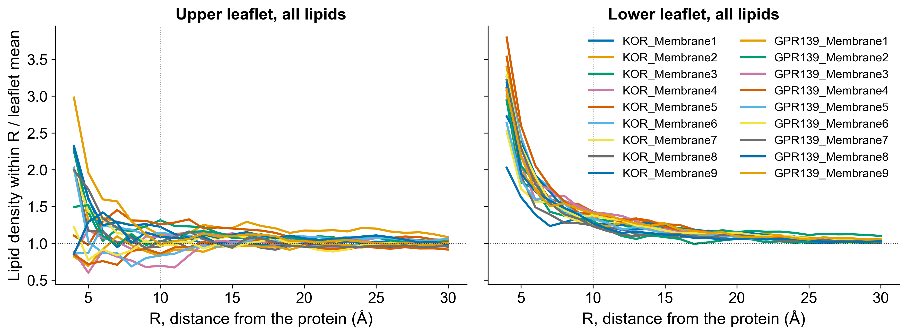

# Membrane quality checks { #5-validation }

What is measured on the membrane at each stage, and how to read areas per lipid, composition and thickness in `membrane_validation.md`.

## 5.1 What is measured, and where

Every stage is reduced to one record per lipid (anchor position, leaflet, species) and the heavy atoms of the
complex, so the same code measures the coarse-grained and the atomistic stages. The report's stage matrix:

| Validation | CG frame | Embed | Slice | Backmap | Minimized | Equilibrated | Final |
|---|---|---|---|---|---|---|---|
| CG frame quality (absolute, before embedding) | ✓ | | | | | | |
| Ring penetration / clashes (build) | | | ✓ | ✓ | ✓ | | |
| Voronoi APL (global and per species) | ✓ | ✓ | ✓ | ✓ | ✓ | ✓ | ✓ |
| Lateral headgroup RDF | ✓ | ✓ | ✓ | | | | |
| Lipids around the protein (per species, per leaflet) | | ✓ | ✓ | ✓ | ✓ | ✓ | ✓ |
| Bilayer thickness (global, local map) | ✓ | ✓ | ✓ | ✓ | ✓ | ✓ | ✓ |
| Composition / leaflet asymmetry | ✓ | ✓ | ✓ | ✓ | ✓ | ✓ | ✓ |
| Z-density / core hydration | | | | | ✓ | ✓ | ✓ |
| Tail interdigitation | | | | ✓ | ✓ | ✓ | ✓ |
| Protein tilt / insertion depth | ✓ | ✓ | ✓ (diagnostic) | ✓ | ✓ | ✓ | ✓ |
| Tail order S_CD | | | | | | ✓ | ✓ |
| Area / volume convergence | | | | | | ✓ | ✓ |
| Lateral diffusion, K_A, leaflet tension | | | | | | | ✓ |

The build runs the first five columns. The last two need a trajectory and are run afterwards with
`python -m membraneforger.equilibration` (section 5.9). The lateral RDF is confined to the coarse-grained stages
because the all-atom anchors (P, O3, NF) are not the Martini beads: a cross-resolution curve is reported in the
JSON but not graded. Everything ends in one record format (`membraneforger/qc.py`): metric, stage, leaflet, value,
units, reference, uncertainty, N, deviation, status (PASS / WARNING / FAIL / INSUFFICIENT SAMPLING / REFERENCE
NEEDED / NOT RUN) and the reason. Poor sampling is never turned into a PASS or a FAIL.

## 5.2 Two different areas per lipid

Keep these apart; the report does.

- **Global leaflet APL**: `APL_global = (A_xy - A_protein) / N_lipids`. It tests overall packing.
- **Local, per-lipid area**: the cell of each lipid in a 2D periodic Voronoi tessellation of its leaflet, generated
  from the headgroup anchors with the heavy atoms of the complex that lie between the midplane and the headgroup
  plane as additional generators whose cells are discarded. The protein footprint is therefore never assigned to a
  lipid, `sum(A_i) = A_xy - A_protein` exactly (A_protein is the summed area of the protein generators' cells), and the
  global APL is the mean of the per-lipid areas. This is an anchor-based area, one generator per lipid; it is not the
  all-atom APL@Voro sum of atom cells, so the two are not interchangeable.
- **Species APL**: the mean (and median, SD, IQR) of the per-lipid areas of that species, per leaflet.
  "Available area divided by the number of POPC" is not the APL of POPC in a mixed bilayer and is not computed.
- **Head-plane area**: a second tessellation of the phosphate/amide anchors alone, sterols left out because their
  ROH sits about 0.5 nm below the phosphate plane. This is the area per lipid head in the headgroup plane
  (59-66 A^2 in the KOR build against 46-51 A^2 for the all-lipid value, the difference being the cholesterol).

## 5.3 Slicing and the global APL

The slice is compared with the embedded membrane in two ways, and only the first is a pass/fail criterion:

- **Construction check**: the leaflet APL of the slice against the Voronoi areas of the **same lipids in the
  uncut embedded membrane**. The cut keeps those lipids with their neighbours; only the new seam can change their
  areas, so this isolates what slicing did. PASS within 3 %, WARNING to 5 %, FAIL beyond (and the build stops
  before backmapping unless `--apl-validate no`; `--apl-tolerance` moves the FAIL ceiling).
- **Representativeness**: the slice against the whole embedded cell, and the lipid count against the count the
  reference APL predicts for the accessible area of the new cell. A finite crop around a protein samples the
  membrane next to that protein, not the cell average, so this is graded against the empirical distribution of
  equal-size windows cut everywhere in the embedded membrane (central 95 % PASS, 95-99 % WARNING) and never stops
  the build.

Measured on the bundled kappa opioid receptor frame KOR with the oriented glucagon receptor complex (GCGR)
embedded, sliced with the default settings (centred window; the values come from `membrane_validation.md`; the old-rule row is the lipid
count the all-beads-inside rule keeps in the same window, with the APL that count implies):

| Stage / algorithm | Upper lipids | Lower lipids | Upper APL (A^2) | Lower APL (A^2) | dAPL upper vs embed | dAPL lower vs embed | Verdict |
|---|---:|---:|---:|---:|---:|---:|---|
| CG frame (frame's own receptor) | 671 | 631 | 48.0 | 51.0 | | | |
| Embedded CG membrane (reference) | 666 | 613 | 47.7 | 48.9 | reference | reference | |
| Old all-beads-inside slice | 225 | 200 | 56.8 | 54.9 | +19.1 % | +12.4 % | FAIL |
| New anchor slice, centred + relaxed seam | 272 | 241 | 47.0 | 45.6 | -1.5 % | -6.7 % | PASS |
| same lipids in the uncut membrane | 272 | 241 | 47.6 | 45.7 | construction: -1.24 % | -0.31 % | PASS |

The old rule deleted 88 lipids whose anchor was inside the window because one tail bead
crossed the edge. The new slice keeps them; the seam relaxation moved 238 lipids by 0.023 nm on average (0.33 nm at
most) and removed none. The lower leaflet is 6.7 % denser than the whole embedded cell (percentile 0.75 of 144
equal-size windows): the construction check passes, the difference is where the window sits. With the offset search
(`--slice-offset-search`) the same frame gives 267 / 240 lipids, +0.4 % / -6.3 % against the whole cell and
+0.8 % / +0.5 % construction deviation.

Over all 18 bundled 50 us frames (36 leaflets, GCGR complex, centred window) the construction deviation of the
new slice has a median of 0.94 %, a 95th percentile of 2.71 % and a largest value of 3.58 % (1.27, 3.71 and 4.13 % with
`--slice-offset-search` on the 17 frames it completes; on GPR139_Membrane5 the search's lower leaflet reaches +5.5 % and the
build stops), so the 3 % warning level is crossed on two leaflets (GPR139_Membrane6 upper, KOR_Membrane5 lower) and the 5 % limit
on none; the old all-beads-inside rule would have failed on every frame
(+11.1 to +22.9 % upper, +4.2 to +12.6 % lower, 69-97 fewer lipids). The whole-cell
deviation of a correct crop scatters more (standard deviation 2.5 % upper and 2.8 % lower leaflet, worst case 16.7 %, lower leaflet of GPR139_Membrane3), which is why it is reported as representativeness
and not used to stop the build; eight frames (GPR139_Membrane1, 2, 3, 6 and 8, KOR_Membrane5, 6 and 8) end PASS WITH WARNINGS on it.

The repaired slice therefore preserves the embedded membrane's packing to within 2-3 % per leaflet on the
representative cases and within 4 % on every bundled frame tested; it does not preserve it "perfectly", and the
report says by how much.

Area per lipid (A^2, Voronoi, protein footprint excluded) at each stage for the 18 bundled frames with the GCGR complex
(centred window; the last column is the construction deviation with `--slice-offset-search`). "Uncut" is the same lipids as the slice, in the embedded membrane; the construction
deviation is the slice against them. Head-plane is the area per phosphate/amide anchor (section 5.2).

| Frame | Leaflet | CG frame | Embedded | Slice | Uncut | Construction | Head-plane embedded | Head-plane slice | Construction, offset search |
|---|---|---:|---:|---:|---:|---:|---:|---:|---:|
| KOR_Membrane1 | upper | 47.99 | 47.72 | 47.01 | 47.6 | -1.24 % | 65.72 | 63.12 | +0.76 % |
| KOR_Membrane1 | lower | 51.04 | 48.87 | 45.58 | 45.72 | -0.31 % | 63.47 | 59.67 | +0.49 % |
| KOR_Membrane2 | upper | 47.87 | 47.64 | 46.39 | 46.04 | +0.77 % | 65.84 | 63.48 | +2.02 % |
| KOR_Membrane2 | lower | 51.66 | 49.29 | 44.97 | 44.53 | +0.98 % | 63.47 | 57.38 | -0.26 % |
| KOR_Membrane3 | upper | 47.36 | 47.24 | 45.77 | 45.65 | +0.27 % | 66.06 | 63.33 | +0.58 % |
| KOR_Membrane3 | lower | 52.11 | 49.99 | 47.06 | 46.27 | +1.70 % | 63.59 | 59.82 | +3.67 % |
| KOR_Membrane4 | upper | 48.1 | 47.97 | 46.99 | 46.9 | +0.19 % | 65.96 | 63.44 | +1.06 % |
| KOR_Membrane4 | lower | 50.8 | 48.53 | 45.04 | 43.91 | +2.58 % | 63.18 | 58.19 | +3.52 % |
| KOR_Membrane5 | upper | 46.76 | 46.79 | 44.89 | 45.57 | -1.50 % | 65.37 | 62.35 | +0.66 % |
| KOR_Membrane5 | lower | 51.63 | 49.19 | 44.55 | 43.21 | +3.10 % | 62.38 | 58.05 | +1.83 % |
| KOR_Membrane6 | upper | 47.12 | 46.9 | 46.5 | 46.87 | -0.79 % | 65.51 | 65.01 | +1.65 % |
| KOR_Membrane6 | lower | 51.92 | 49.76 | 44.65 | 45.34 | -1.52 % | 63.29 | 57.41 | +0.21 % |
| KOR_Membrane7 | upper | 46.9 | 46.68 | 45.76 | 46.18 | -0.90 % | 66.05 | 64.34 | +0.63 % |
| KOR_Membrane7 | lower | 52.72 | 50.38 | 43.98 | 43.31 | +1.55 % | 63.24 | 56.13 | +3.66 % |
| KOR_Membrane8 | upper | 48.05 | 48.2 | 46.88 | 45.95 | +2.02 % | 66.6 | 65.93 | -0.04 % |
| KOR_Membrane8 | lower | 51.2 | 49.11 | 43.99 | 44.09 | -0.24 % | 63.8 | 58.29 | -0.69 % |
| KOR_Membrane9 | upper | 47.75 | 47.64 | 46.58 | 46.57 | +0.02 % | 66.35 | 64.21 | +2.54 % |
| KOR_Membrane9 | lower | 51.89 | 50.33 | 46.05 | 45.85 | +0.43 % | 64.16 | 58.99 | +0.91 % |
| GPR139_Membrane1 | upper | 46.87 | 46.98 | 44.04 | 44.68 | -1.42 % | 64.75 | 62.28 | +2.34 % |
| GPR139_Membrane1 | lower | 50.12 | 48.45 | 45.27 | 45.49 | -0.49 % | 62.91 | 58.94 | +0.71 % |
| GPR139_Membrane2 | upper | 47.39 | 47.39 | 48.21 | 47.35 | +1.81 % | 65.13 | 65.16 | +2.09 % |
| GPR139_Membrane2 | lower | 50.06 | 48.43 | 44.12 | 44.32 | -0.44 % | 63.27 | 58.45 | +2.30 % |
| GPR139_Membrane3 | upper | 46.57 | 46.55 | 47.01 | 46.9 | +0.24 % | 64.99 | 65.66 | +1.49 % |
| GPR139_Membrane3 | lower | 50.85 | 48.38 | 40.31 | 40.7 | -0.97 % | 61.37 | 52.64 | +1.33 % |
| GPR139_Membrane4 | upper | 46.49 | 46.46 | 45.36 | 45.85 | -1.08 % | 65.0 | 62.41 | +1.20 % |
| GPR139_Membrane4 | lower | 51.24 | 49.19 | 46.73 | 46.44 | +0.63 % | 62.91 | 58.55 | +2.08 % |
| GPR139_Membrane5 | upper | 46.86 | 46.95 | 46.38 | 45.86 | +1.13 % | 65.8 | 64.27 | stopped |
| GPR139_Membrane5 | lower | 51.39 | 49.7 | 46.73 | 46.88 | -0.32 % | 63.66 | 60.49 | +5.5 % (stopped) |
| GPR139_Membrane6 | upper | 46.76 | 46.83 | 49.09 | 47.39 | +3.58 % | 65.48 | 66.37 | -0.28 % |
| GPR139_Membrane6 | lower | 51.51 | 49.6 | 46.53 | 46.58 | -0.10 % | 62.83 | 58.04 | +0.81 % |
| GPR139_Membrane7 | upper | 46.93 | 47.05 | 46.18 | 46.49 | -0.67 % | 65.15 | 63.04 | +1.11 % |
| GPR139_Membrane7 | lower | 51.29 | 49.54 | 46.77 | 46.46 | +0.66 % | 63.7 | 59.23 | +3.78 % |
| GPR139_Membrane8 | upper | 47.65 | 47.57 | 45.49 | 45.9 | -0.90 % | 65.59 | 63.92 | +1.71 % |
| GPR139_Membrane8 | lower | 50.99 | 49.12 | 43.95 | 44.93 | -2.18 % | 63.69 | 56.58 | +1.58 % |
| GPR139_Membrane9 | upper | 47.52 | 47.3 | 48.29 | 47.72 | +1.20 % | 65.17 | 63.65 | +0.28 % |
| GPR139_Membrane9 | lower | 50.61 | 48.62 | 44.44 | 43.33 | +2.56 % | 63.02 | 58.88 | +4.13 % |

The KOR_Membrane1 rows are the stage table above. With the centred window two leaflets cross the 3 % construction warning level
(`GPR139_Membrane6` upper, +3.58 %; `KOR_Membrane5` lower, +3.10 %; PASS WITH WARNINGS); with the search five do (3.5-4.1 %) and
`GPR139_Membrane5` lower (+5.5 %) crosses the 5 % limit, which stops the build.

## 5.4 Composition and leaflet asymmetry

For each leaflet and species the report gives N and the mole fraction in the reference and in the slice, the
difference in mole percent, the sampling standard deviation a random crop of that many lipids would have, and the
composition distance `D_comp = 0.5 * sum |x_slice - x_reference|` (the total variation distance). D_comp is graded against shell-stratified draws around the complex
(5000 random re-draws of the slice that keep its number of lipids in each shell of 0.5, 1.0, 1.5, 2.0 and 3.0 nm around the protein,
so the cholesterol and PIP2 enrichment next to the protein is part of the expectation and only the bulk the slice samples varies;
`packing.shell_stratified_null`). The percentile of the equal-size windows is still reported beside it, and a distance within three
times the multinomial expectation is accepted as before unless the percentile grade is already FAIL. Rare species (PIP2, GM3,
10-20 molecules in a cut) are shown with their N and flagged "(few)" below 10; their mole fractions move by one or
two points between reference and slice and their species APL has a standard deviation of 20-25 A^2 across molecules,
so a difference of a few percent in their mean carries no weight.

## 5.5 Species-specific APL

The species table (and `membrane_validation_species.png`) lists, per stage, leaflet and species: N, mean, median,
SD and head-plane area of the per-lipid Voronoi cells, the mole fraction, and the change against the reference.
In the KOR build the well-sampled species (N >= 30) change by -9.9 to +8.4 % between the embedded membrane and
the slice (largest: lower CHOL -9.9 %, upper PSM +8.4 %), a wider spread than the global check; upper DOPE, with 9
molecules, moves by +6.9 % and is marked. Cholesterol's cell (38 A^2 in the upper leaflet, 35 in the lower) is smaller
than a phospholipid's (46-55 A^2 for N >= 10) because its anchor shares the plane with the phosphates it sits between;
the head-plane column, which excludes it, is the area a phospholipid head occupies among heads (55-69 A^2 for N >= 10).
Per-lipid areas are written to `membrane_validation_lipids.tsv`.

## 5.6 Bilayer thickness and protein orientation

Thickness is the distance between the median anchor z of the two leaflets (non-sterol lipids), plus a 1 nm local
map whose spread is reported. Protein orientation is the tilt of the principal axis of the complex's heavy atoms
within 1.5 nm of the midplane, its insertion depth (mean z of those atoms relative to the midplane) and an inversion
flag. Across slicing (gate 1) thickness is graded: it may change by 3 / 5 % (PASS / WARNING) against the embedded membrane.
Slicing only removes and shifts lipids and never moves the complex, so its tilt, insertion depth and side of the membrane are the embedded values to
rounding; they are reported at the slice stage as diagnostics (NOT RUN, deviation 0.0) and graded where they can change,
across backmapping and minimization (tilt 2 / 5 degrees, depth 1 / 2.5 A). In the 50 us KOR example embedding changes thickness by 0.1 %
(42.58 to 42.61 A) and slicing by -2.0 % (41.74 A, PASS; -1.7 % with the offset search). An earlier version of the report dropped this
slice-stage thickness record: its merge with the gate's own records compared metric names across all stages, so the
`bilayer thickness` of the CG frame and of the embedded membrane hid the slice's. It is now compared with the gate's records only.

## 5.6a Lipids around the protein

The lateral RDF above is lipid to lipid; how each species is distributed around the protein is a separate profile
(`rdf.protein_density_profiles`, section "Lipids around the protein" of `membrane_validation.md`, figure
`membrane_validation_protein_density.png`). For every lipid of a leaflet it takes the in-plane distance from the
headgroup anchor to the nearest protein heavy atom of the protein's cross-section at headgroup depth (within 0.6 nm
of the leaflet's median anchor z). Each distance shell's membrane area is measured on a 0.05 nm grid (the protein is
not a cylinder), and the species' density is divided by its mean density over the leaflet's lipid-accessible area:
1 = as common as anywhere, > 1 enriched next to the protein, < 1 depleted. One frame puts zero or one molecule of a
species in each shell, so the figure shows the cumulative ratio, the density within R over the leaflet mean (a
depletion-enrichment index), which tends to 1 far from the protein; the table gives its value at 10 A, the first
shell, with the counting uncertainty (ratio / sqrt(n)). The cross-section is taken at headgroup depth because a
tilted helix shifts laterally by up to 2 nm across a leaflet: against all protein atoms of the leaflet, even the
total lipid density read 1.3-1.4 at the protein for a single-pass protein tilted 53 degrees (0.9-1.1 at headgroup
depth). The CG frame stage is left out: its protein is the frame's own receptor, not the complex.

*Figure 2. Cumulative density of all lipids within R of the protein over the leaflet mean, slice stage, GCGR complex,
for each bundled frame and leaflet; 1 = as common as anywhere. The first shell (R = 10 A) is marked.*

Ratio at 10 A, with the lipids in the shell and in the leaflet in brackets:

| Frame | Upper, embedded | Upper, slice | Lower, embedded | Lower, slice |
|---|---|---|---|---|
| KOR_Membrane1 | 1.12 (28/666) | 1.12 (28/272) | 1.37 (70/613) | 1.25 (69/241) |
| KOR_Membrane2 | 1.15 (29/671) | 1.11 (28/276) | 1.44 (73/611) | 1.34 (72/242) |
| KOR_Membrane3 | 1.35 (34/677) | 1.31 (34/281) | 1.35 (68/601) | 1.33 (68/232) |
| KOR_Membrane4 | 1.08 (27/662) | 1.08 (27/272) | 1.45 (75/618) | 1.40 (74/244) |
| KOR_Membrane5 | 1.30 (33/676) | 1.26 (33/286) | 1.55 (79/606) | 1.43 (80/249) |
| KOR_Membrane6 | 1.14 (29/676) | 1.14 (29/276) | 1.46 (74/603) | 1.34 (74/246) |
| KOR_Membrane7 | 0.98 (25/684) | 0.98 (25/279) | 1.51 (75/597) | 1.26 (74/251) |
| KOR_Membrane8 | 1.01 (25/662) | 0.95 (24/273) | 1.34 (68/608) | 1.24 (68/244) |
| KOR_Membrane9 | 1.24 (31/672) | 1.22 (31/275) | 1.35 (67/599) | 1.26 (67/239) |
| GPR139_Membrane1 | 0.87 (22/663) | 0.83 (22/290) | 1.31 (68/605) | 1.26 (66/241) |
| GPR139_Membrane2 | 0.95 (24/660) | 1.03 (25/265) | 1.38 (71/607) | 1.31 (70/246) |
| GPR139_Membrane3 | 0.67 (17/671) | 0.69 (17/269) | 1.74 (89/612) | 1.42 (91/274) |
| GPR139_Membrane4 | 0.86 (22/675) | 0.86 (22/280) | 1.42 (72/599) | 1.39 (72/231) |
| GPR139_Membrane5 | 0.83 (21/672) | 0.83 (21/275) | 1.31 (66/597) | 1.33 (67/232) |
| GPR139_Membrane6 | 0.91 (23/672) | 0.96 (23/259) | 1.43 (72/598) | 1.38 (73/235) |
| GPR139_Membrane7 | 1.03 (26/671) | 1.02 (26/278) | 1.23 (62/599) | 1.23 (62/233) |
| GPR139_Membrane8 | 1.12 (28/666) | 1.09 (28/281) | 1.39 (71/610) | 1.27 (72/252) |
| GPR139_Membrane9 | 0.95 (24/667) | 0.99 (24/265) | 1.53 (79/611) | 1.41 (79/249) |

The lower leaflet is enriched next to the protein in every frame (1.23-1.74) and the upper leaflet ranges from depleted
(GPR139_Membrane3, 0.67) to enriched (KOR_Membrane3, 1.35). Figure 2 is drawn from the same centred slices as the table.

**Reading the minimized and trajectory .gro files.** The .gro format keeps 5 characters of a residue name (SAPI25 is
written SAPI2) and the GM3 topology splits each molecule into four residues (CER160 BGLC BGAL ANE5AC, written CER16
BGLC BGAL ANE5A). The minimized stage and the equilibration frames therefore take their molecules from the build's
topology (`topol.top` and its .itp files), which is exact; without a topology that matches the file, the residue
names are mapped back with those two rules. A molecule that is neither lipid, protein nor solvent is reported
(`WARNING`, "molecules identified") and left out of every measurement.
