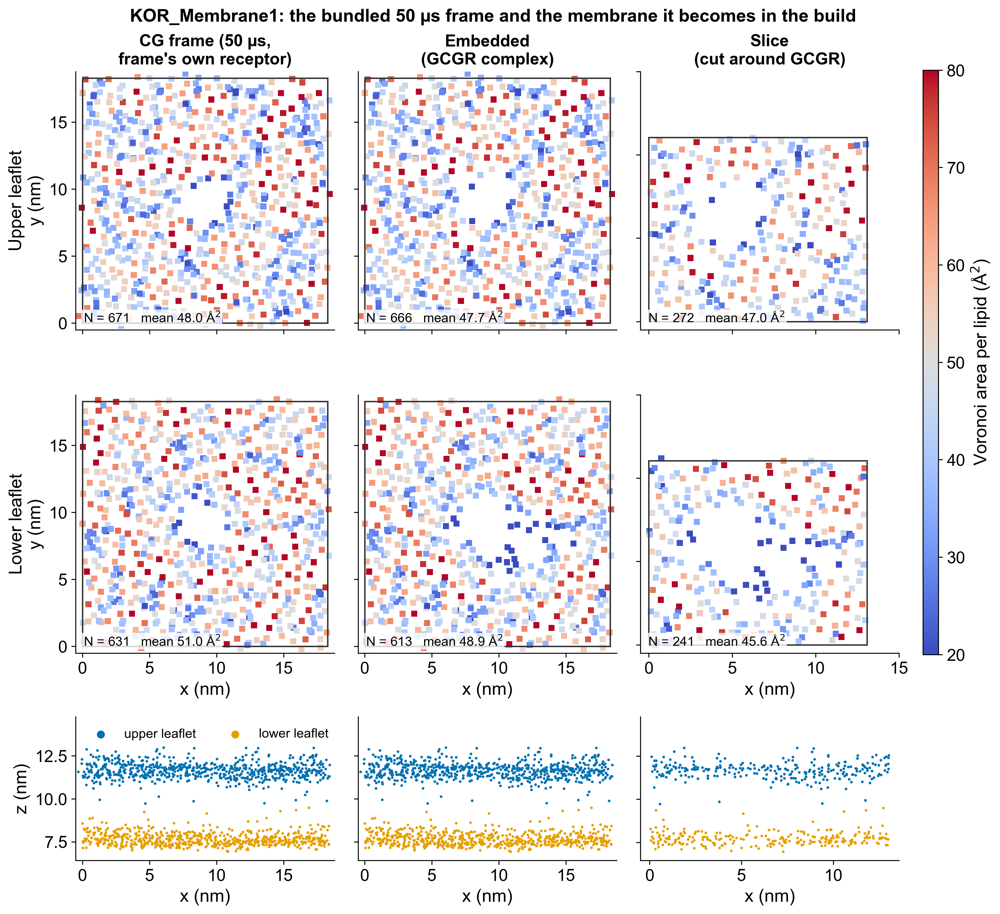

# Placement and slicing

How the complex goes into the coarse-grained frame, and how the membrane is cut down to the complex plus a buffer.

## 2. Placement and embedding

With a bundled membrane (or `--embed`) the oriented complex is placed where the frame's own receptor was (or, with
`--embed-site free`, on the unbroken bilayer away from it; see below), its
bilayer centre on the midplane found between the two PO4 planes (an oriented complex has it at z = 0; with
`--orientation none` it is `--bilayer-z`, else the midpoint of the CA z range of the segment `--orient-residues`
names, else the hydrophobic-belt search), and room is made for it (`embed_complex`). With
your own frame of the same complex the all-atom structure is fitted onto the frame's coarse-grained protein instead
and nothing is removed.

Room is made by moving lipids, not by deleting every lipid the complex touches. Every lipid with a bead within
0.40 nm of a heavy atom of the complex is pushed away at the coarse-grained level with the same restrained
steepest descent that relaxes the slice seam (`slicing.relax_seam`): a soft repulsion from the heavy atoms (range
0.45 nm), weak position restraints, restraints that keep each lipid's shape, and repulsion between lipid beads
that the push brings together (contact 0.30 nm), for 1200 steps. Only a lipid that still has a bead closer than
0.30 nm to a heavy atom afterwards is removed: the complex occupies its place. The log and `run_manifest.json`
(`embedding`) give how many lipids touched the complex, how many were removed (by species and leaflet), how far the
kept lipids moved and how much their shape changed, and the closest remaining bead.

Why: the earlier rule removed every lipid with any bead within 0.40 nm. A G protein's lipid anchors (the Ggamma
geranylgeranyl chain, the Galpha N-terminus) reach into the inner leaflet, and with the GCGR–Gs complex
that rule deleted every one of the 78-100 lipids touching the complex on the 18 bundled frames, many of them only for touching those
anchors. Each deleted lipid took its whole tail with it, leaving an empty column in the inner leaflet that solvation does not fill (water is
removed between the phosphate planes) and that the area-per-lipid gate cannot see (the Voronoi cells of the anchor
atoms absorb it). The current rule removes 15-32 lipids on the 18 bundled 50 us frames. Removing only lipids whose headgroup
anchor the complex occupies was also tried and rejected: next to a thin anchor it still deletes lipids whose volume
nothing replaces.

**Empty-pocket gate.** After embedding, the acyl region of each leaflet (0.3 nm off the midplane to 0.3 nm inside
its PO4 plane) is sampled on a 0.1 nm grid; a point farther than 0.60 nm from every lipid bead and every heavy atom
of the complex is empty, and touching empty points form a pocket (`membrane_voids`, periodic in x and y). A pocket
larger than 1.0 nm^3, less than the volume of one phospholipid, stops the build before slicing, naming the leaflet and
the position. On the 18 bundled 50 us frames with the GCGR complex: uncut frames 0.001-0.291 nm^3, this embedding
0.019-0.271 nm^3. If the gate stops a build, the frame's cavity cannot be adapted to the
complex by moving lipids; use a coarse-grained frame of the complex itself (`--cg FILE`) or another frame.

**Embedding site (`--embed-site`).** A bundled frame was equilibrated around a receptor, and where the receptor was
it has a hole of the receptor's shape (empty acyl volume once the receptor is taken out). The default site, `hole`, puts the complex there, which suits another receptor of similar size. A much smaller
complex cannot fill it: a single-pass protein (one transmembrane helix) left a pocket of 1.7-3.2 nm^3 in the receptor's hole of every bundled 50 us frame (3.18 nm^3 in GPR139_Membrane3, 2.53 nm^3 in
KOR_Membrane1, 1.68 nm^3 in KOR_Membrane5) even after the push, and the empty-pocket gate stops the build with a message naming the other site.
With `--embed-site free` the complex goes on unbroken membrane instead, and the push makes room for it. The site is
chosen for the membrane that will be cut around the complex, not for its helix alone: the slice window (the
complex's x/y extent plus `--xy-buffer`, or `--box`, plus the 0.5 nm crop offset the slicer may take;
`embedding.slice_window`) is tried at every point of the cell, and the point where it stays farthest from the
frame's receptor is used (`embedding.free_site`, periodic in x and y). The window must keep 1.0 nm from every
receptor bead (`FRAME_PROTEIN_CLEARANCE_NM`: in the bundled frames no lipid bead comes closer than 0.32-0.37 nm to
a receptor bead, so the hole reaches that far past the bead centres); if no point does, the build stops before the
push. The receptor's beads count as solid in the pocket search, and after slicing the build checks the actual window
again (`frame_protein_in_slice`). A single helix with the default 1 nm buffer gives a cell of
about 4 nm, where the cut edges alone can move the APL past the slice gate; give it a larger buffer (`--xy-buffer 3`;
with it all 18 bundled frames pass the slice gate with the centred window, the construction deviation within 2.7 %).

The membrane that exists after this step is the **embedded membrane**. It is the reference every later stage is
compared with: it is the membrane the slice is actually cut from. The uncut frame is also measured ("CG frame"
row) so that the effect of embedding itself is visible; this comparison is reported and not graded. It is not a
measure of packing: the frame's footprint is tessellated with the coarse-grained protein beads and the embedded
membrane's with the complex's heavy atoms, which are far denser generators. On the matched GCGR frame the same lipids
give a lower-leaflet APL of 57.3 A^2 with the CG protein and 48.3 A^2 with the fitted all-atom complex.

*Figure 1. The coarse-grained membrane of the KOR build at its three coarse-grained stages: the bundled 50 us frame
with its own receptor, the membrane after embedding the GCGR complex, and the slice cut around it (1302, 1279 and 513
lipids). Top-down view of each leaflet and side view (x-z), coloured by the Voronoi area per lipid. "After" means after
embedding and slicing: the build does not equilibrate the coarse-grained membrane, and the figure is drawn by
`membraneforger/examples/make_tutorial_figures.py`.*

## 3. Slicing (BOX = auto)

The window is the complex's x, y extent plus `--xy-buffer` (1.2 nm) on each side; an axis whose window would reach
the cell is not cut. The cut is made lipid by lipid:

1. every lipid is made whole under the periodic boundaries of the source cell;
2. one **anchor** represents the lipid in the plane (`membraneforger/lipids.py`, `LIPID_SLICE_ANCHORS`):

   | Lipid | Martini 3 anchor | atomistic anchor (CHARMM36) |
   |---|---|---|
   | POPC, DOPC, POPE, DOPE, POPS, DOPS, PSM | `PO4` | `P` |
   | PIP2 (`SAP6` / `SAPI25`) | `PO4` (the diester phosphate, not P4/P5) | `P` |
   | cholesterol (`CHOL` / `CHL1`) | `ROH` | `O3` |
   | GM3 (`DPG3` / `GLPA`) | centroid of the three sugar residues' beads (GLC, GAL, NMC) | `NF` (ceramide amide N) |
   | anything else | centre of geometry of the whole residue | centre of geometry of the heavy atoms |

3. the periodic image of the anchor that falls into the **half-open** window `lower <= a < lower + width` is found.
   The window is never wider than the cell, so exactly one image qualifies: no lipid is counted twice and a lipid on
   a boundary is counted on one side only. This is the decision one gets from tiling the membrane 3 x 3 and cutting
   the window out of the tiling, without building the tiling;
4. if the anchor is in the window the **complete residue** is kept and moved rigidly by the same shift; a tail bead
   that crosses the new cell edge stays where it is (mstool runs with `pbc=True`, GROMACS wraps);
5. the window is centred on the complex. Opt in to `--slice-offset-search` and it may be shifted on a cropped axis by
   up to 0.5 nm (never past the 0.5 nm minimum margin) in steps of 0.1 nm, to the offset whose lipid counts best match the
   reference leaflet density and composition. Centred is the default because on the 18 bundled 50 us frames (GCGR complex)
   the construction deviation of section 4 is smaller with the centred window (median 0.94 %, 95th percentile 2.71 %,
   largest 3.58 %) than with the search (1.27, 3.71, 4.13 % on the 17 frames it completes; on GPR139_Membrane5 it
   reaches +5.5 % in the lower leaflet and the build stops), and the search narrows the spread of the whole-cell
   deviation only in the upper leaflet (standard deviation 1.5 against 2.5 %; 2.8 % in the lower leaflet either way). The
   trade-off is in the report: the centred slices of eight frames sit 6-17 % below the whole embedded cell in the lower
   leaflet (PASS WITH WARNINGS on representativeness), where the search gave construction warnings above 3 % on five
   frames (GPR139_Membrane7, GPR139_Membrane9, KOR_Membrane3, KOR_Membrane4, KOR_Membrane7; 3.5-4.1 %);
6. the new periodic seam is relaxed in place at the coarse-grained level: a short steepest descent pushes apart
   beads of different lipids that only the cut brought within 0.30 nm of each other, with the complex as a fixed
   repulsive wall, every bead held near its position and every lipid held in shape by intramolecular distance
   restraints. Pairs that were already that close in the source frame are data and are left alone. Only a lipid
   still in a hard-core overlap (< 0.15 nm) afterwards is removed; on the 18 bundled 50 us frames none was (the seam removed 0 lipids on all of them). The
   relaxation moves 42-56 % of the lipids by 0.016-0.028 nm on average and 0.39 nm at most; 13 frames reach the 400-step cap, the five that converge (GPR139_Membrane4, GPR139_Membrane9, KOR_Membrane3, KOR_Membrane5, KOR_Membrane7) take 122-396 steps.

### Why whole-lipid anchoring

Keeping a lipid only when every bead lies inside the window deletes a band of lipids along every cut edge, because tails
reach a nanometre sideways, while the new cell keeps the full window area: the lipid number falls by 15-30 % per unit area
and the two leaflets lose different amounts. Neither minimization nor NPT can repair this, since both leaflets share one
x, y cell.
